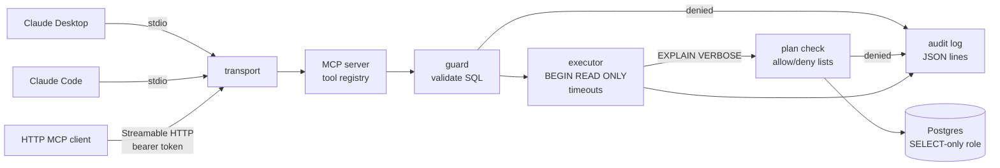

# mcp-db-server

[](https://github.com/hasnatsajid/mcp-db-server/actions/workflows/ci.yml)

A [Model Context Protocol](https://modelcontextprotocol.io) server in Go that
gives AI clients (Claude Desktop, Claude Code, any MCP client) **safe,
read-only** access to a PostgreSQL database for introspection and querying.

Built on the official Go SDK (`modelcontextprotocol/go-sdk`) and `pgx`. Runs
over stdio for desktop clients or Streamable HTTP with bearer-token auth for
shared use.

## Tools

| Tool | Input | Returns |
|---|---|---|
| `list_schemas` | none | Allow-listed schemas that exist, with comments and whether the role has `USAGE` |
| `list_tables` | `schema` | Tables, views, materialized views and foreign tables, with planner row estimates (denied tables hidden) |
| `describe_table` | `schema`, `table` | Columns (type, nullability, default, comment), primary key, foreign keys and other constraints, indexes |
| `query` | `sql`, `params?`, `limit?` | `columns`, `rows`, `row_count`, `truncated` |
| `explain_query` | `sql`, `params?`, `analyze?` | `EXPLAIN (FORMAT JSON)` plan; `analyze` defaults to false |

Every tool is annotated `readOnlyHint` and returns structured content with an
output schema, plus the same JSON as text for older clients. Values are passed
as `params` with `$1, $2 ...` placeholders, never interpolated.

Example `query` result:

```json
{
  "columns": [{"name": "status", "type": "text"}, {"name": "count", "type": "int8"}],
  "rows": [["cancelled", 400], ["paid", 800], ["pending", 400], ["shipped", 400]],
  "row_count": 4,
  "truncated": false
}
```

## Safety model

Defence in depth: no single layer is trusted on its own, and the integration
tests check each one separately.

1. **Least-privilege role.** Connect as a role with `SELECT` grants only (the
   sample setup also revokes the sensitive tables). Permission errors from
   Postgres are reported and audited as denials.
2. **Read-only transactions.** Every call runs in `BEGIN READ ONLY` with
   `statement_timeout`, `lock_timeout` and `idle_in_transaction_session_timeout`
   set locally, and is always rolled back. The connection also sets
   `default_transaction_read_only=on`.
3. **Statement validation.** A lexer that follows PostgreSQL's rules for
   comments (nested), quoted identifiers, `E''` and dollar-quoted strings
   accepts exactly one `SELECT` / `WITH … SELECT` / `VALUES` / `TABLE`
   statement. It rejects data-modifying CTEs, `SELECT INTO`, locking clauses,
   and functions that run SQL from strings (`query_to_xml`, `ts_stat`), change
   settings (`set_config`), touch files or other sessions (`pg_read_file`,
   `lo_*`, `dblink`, `pg_terminate_backend`, advisory locks, `pg_sleep`).
   Queries go over the extended protocol, which refuses multiple statements
   on its own. The validator is fuzzed in CI.
4. **Allow/deny lists, checked on the plan.** Before running a query the
   server plans it with `EXPLAIN (VERBOSE, FORMAT JSON)` (nothing executes)
   and checks every relation the plan reads: its schema must be in
   `ALLOW_SCHEMAS` and it must not be in `DENY_TABLES` (deny wins). Because
   the planner expands views, CTEs and subqueries, a denied table can't be
   reached through a view, join, `EXISTS` or `UNION`. Partitions are checked
   with their partitioned ancestors, so denying a parent denies its partitions.
5. **Row limits.** The query is wrapped as
   `SELECT * FROM (<query>) LIMIT n+1`, so Postgres stops producing rows at the
   cap. Results are capped at `MAX_ROWS` (or a smaller `limit`) and marked
   `truncated`.
6. **Audit log.** Every call is written as a JSON line: time, client name,
   session, tool, target, SQL, parameter **count** (never values), rows,
   truncated, denied, duration, error. Files are created `0600` and opened
   `O_APPEND`; send `SIGHUP` to reopen after rotation.

Secrets stay out of output: the database URL and HTTP token are redacted when
config is printed, and connection errors are reduced to a message without
host, address or credentials.

**Limits.** The plan check sees relations, not the bodies of functions:
a user-defined function in an allowed schema (especially `SECURITY DEFINER`)
can read whatever its owner can. The least-privilege role (layer 1) is the
boundary for that, so grant `SELECT` only on what clients may see.

## Architecture



## Layout

```
cmd/mcp-db-server/   main: config, logger, transport selection, graceful shutdown
internal/config/     env config, validation, redaction
internal/guard/      SQL validator (lexer), plan relation extraction, allow/deny policy
internal/db/         pgx executor: read-only tx, introspection, query, explain
internal/tools/      MCP tool definitions, auditing wrapper
internal/transport/  Streamable HTTP handler with bearer auth
internal/audit/      JSON-lines audit log with reopen
migrations/          sample database schema and data
scripts/             read-only role setup for docker-compose
docs/                client setup guides
```

## Running

```sh
cp .env.example .env    # fill in the placeholders
make up                 # sample Postgres with data and the mcp_readonly role
make build
./bin/mcp-db-server     # stdio (default); MCP_TRANSPORT=http for HTTP
```

Point `DATABASE_URL` at the `mcp_readonly` role (see `.env.example`).

Connect a client: [Claude Desktop](docs/claude-desktop.md) ·
[Claude Code](docs/claude-code.md).

### Configuration

| Variable | Default | Notes |
|---|---|---|
| `DATABASE_URL` | required | Use a role with `SELECT` grants only |
| `MCP_TRANSPORT` | `stdio` | `stdio` or `http` |
| `HTTP_ADDR` | `127.0.0.1:8090` | HTTP mode only |
| `HTTP_AUTH_TOKEN` | required for http | At least 32 characters; `openssl rand -hex 32` |
| `MAX_ROWS` | `500` | 1–10000 |
| `QUERY_TIMEOUT` | `5s` | Per statement |
| `ALLOW_SCHEMAS` | `public` | Comma-separated |
| `DENY_TABLES` | empty | Comma-separated `schema.table` |
| `AUDIT_LOG_PATH` | empty (stderr) | JSON lines |
| `LOG_LEVEL` | `info` | `debug`, `info`, `warn`, `error` |
| `LOG_FORMAT` | `json` | `json` or `text`; logs always go to stderr |
| `SHUTDOWN_TIMEOUT` | `5s` | HTTP drain time |

## Testing

```sh
make test               # unit tests, no network
make test-integration   # needs MCP_TEST_DATABASE_URL (e.g. `make up`)
make fuzz               # fuzz the SQL validator
make lint
```

The integration tests connect with a privileged role on purpose and prove
that writes, DDL, multiple statements, locking, setting changes and denied
tables (directly, through views, subqueries, CTEs, unions and partitions) are
rejected, that the read-only transaction alone blocks writes when the
validator is bypassed, and that the statement timeout fires.

## Roadmap

- [x] Scaffold, config, CI
- [x] stdio and HTTP entry points with graceful shutdown
- [x] MCP protocol via the official Go SDK (`modelcontextprotocol/go-sdk`)
- [x] `list_schemas`, `list_tables`, `describe_table` from `pg_catalog`
- [x] Statement validator (single statement, SELECT only), fuzzed
- [x] `query` with parameters, row limit, timeout, read-only tx
- [x] `explain_query`
- [x] Allow/deny list enforcement on the query plan
- [x] Audit log writer (JSON lines, rotation-friendly)
- [x] Streamable HTTP transport with bearer-token auth
- [x] Sample database + read-only role in docker-compose
- [x] Integration tests proving writes, DDL and multi-statements are rejected
- [ ] OAuth (protected resource metadata) for the HTTP transport
- [ ] Column-level deny rules

## License

MIT
