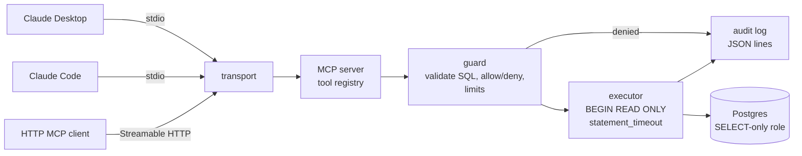

# mcp-db-server

[](https://github.com/hasnatsajid/mcp-db-server/actions/workflows/ci.yml)

A [Model Context Protocol](https://modelcontextprotocol.io) server in Go that
gives AI clients (Claude Desktop, Claude Code, any MCP client) **safe,
read-only** access to a PostgreSQL database for introspection and querying.

> Status: **scaffold**. Config, both transport entry points (stdio loop and
> HTTP server) with graceful shutdown, tool names, and the guard/audit types.
> MCP protocol handling and the tools are next.

## Tools

| Tool | Description |
|---|---|
| `list_schemas` | Schemas the policy allows |
| `list_tables` | Tables and views in a schema, with row estimates |
| `describe_table` | Columns, types, nullability, defaults, PK/FK, indexes |
| `query` | Parameterized read-only `SELECT` with row limit and timeout |
| `explain_query` | `EXPLAIN (FORMAT JSON)` plan; `ANALYZE` off by default |

## Safety model

Defence in depth: no single layer is trusted on its own.

1. **Least-privilege role.** Connect as a role with `SELECT` grants only.
2. **Read-only transactions.** Every call runs in `BEGIN READ ONLY` with
   `SET LOCAL statement_timeout`.
3. **Statement validation.** Exactly one statement; only `SELECT`/`WITH ... SELECT`/`EXPLAIN`.
4. **Allow/deny lists.** Schema allow list, table deny list (deny wins).
5. **Row limits.** Results capped at `MAX_ROWS` and marked as truncated.
6. **Audit log.** Every call written as a JSON line: tool, SQL, parameter
   count (never values), rows, duration, error.

## Architecture



## Layout

```
cmd/mcp-db-server/   main: config, transport selection, graceful shutdown
internal/config/     env config (+ table-driven tests)
internal/guard/      read-only enforcement and allow/deny policy
internal/audit/      audit log entries
internal/tools/      tool definitions
docs/                client setup guides
```

## Running

```sh
cp .env.example .env
make up                                # sample Postgres
make build
MCP_TRANSPORT=http ./bin/mcp-db-server # or stdio (default)
```

Connect a client: [Claude Desktop](docs/claude-desktop.md) ·
[Claude Code](docs/claude-code.md).

## Roadmap

- [x] Scaffold, config, CI
- [x] stdio and HTTP entry points with graceful shutdown
- [ ] MCP protocol via the official Go SDK (`modelcontextprotocol/go-sdk`)
- [ ] `list_schemas`, `list_tables`, `describe_table` from `pg_catalog`
- [ ] Statement validator (single statement, SELECT/EXPLAIN only)
- [ ] `query` with parameters, row limit, timeout, read-only tx
- [ ] `explain_query`
- [ ] Allow/deny list enforcement
- [ ] Audit log writer (JSON lines, rotation-friendly)
- [ ] Streamable HTTP transport with bearer-token auth
- [ ] Sample database + read-only role in docker-compose
- [ ] Integration tests proving writes, DDL and multi-statements are rejected

## License

MIT
